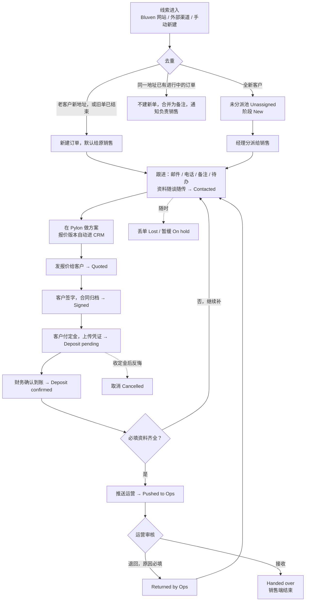

# Bluven CRM 销售端流程说明

版本：v1.2
日期：2026-11-10
读者：销售、销售经理、财务、运营，以及所有需要了解销售端怎么运转的人
配套文档：技术设计见 `docs/sales-crm-design.md`

---

## 1. 这份文档说什么

CRM 的销售端负责一件事：把一条线索变成一张运营可以直接开工的订单。

这份文档按一条线索的实际走向，逐步说明每一步谁来做、系统自动做什么、做完之后订单处于什么状态。看完应该能回答三个问题：

1. 我现在手上这张订单处于哪一步，下一步该做什么。
2. 什么情况下系统会自动动作，什么情况下必须我动手。
3. 推给运营之前，到底要准备齐哪些东西。

系统界面是英文的，下文把界面上的英文名称和中文含义一起写出来。

---

## 2. 参与的人

| 角色 | 界面名称 | 看到什么 | 主要做什么 |
|---|---|---|---|
| 销售 | Sales | 只看自己名下的客户和订单，看不到同事的 | 跟进客户、记录沟通、上传资料、发报价、归档合同、推送运营、被退回后补件 |
| 销售经理 | Manager | 全部客户和订单 | 分派线索、改派、批量转移、维护丢单原因和必填清单、看仪表盘和操作日志 |
| 财务 | Finance | 等待确认定金的订单，其它只读 | 确认或驳回定金到账 |
| 运营 | Ops | 只看已经推送过来的订单，推送之前什么都看不到 | 接收或退回订单，查看交接包、资料、邮件记录和 AI 总结 |
| 管理员 | Admin | 全部 | 用户、角色、系统配置 |

一个账号可以同时有多个角色，比如经理兼管理员。财务是独立账号。

---

## 3. 几个基本概念

**客户、房产、订单是三层。**
客户是人，房产是地址，订单是一次销售机会。一个客户可以有多处房产，每处房产可以有多张订单，比如两年后回来加装电池。我们日常说的"单子"就是订单。线索一进系统就是一张订单，只是处于最早的阶段。

**所有沟通记录在客户的时间线上。**
邮件、电话、备注、阶段变化、资料上传、系统动作，按时间排成一条线。客户只有一张进行中的订单时，所有记录自动归到这张订单；有多张时，销售选一下归到哪张。

**文件夹按"客户 / 房产地址 / 订单号"三层展开。**
运营拿到一张订单，只会看到这一个地址的东西，不会混。

---

## 4. 一条线索的完整走向

下图是主线，后面逐步解释。

### 第 1 步：线索进入

线索有三个来源：

- **Bluven 网站**：客户在网站提交表单，网站自动把线索推到 CRM，几十秒内出现。
- **外部渠道**：购买的线索或合作方，由经理上传表格导入，或对方系统直接推送。
- **手动新建**：销售或经理自己录一条，比如电话打进来的。

每条线索都带来源，后面报表按来源算转化率。

### 第 2 步：去重

线索进来时系统先按邮箱、电话、地址比对已有客户，有四种结果：

| 情况 | 系统怎么做 |
|---|---|
| 全新的人 | 新建客户、房产、订单，进未分派池 |
| 老客户，新地址 | 在老客户下新建房产和订单，默认分给原来的销售，原销售已离职则进池 |
| 老客户，同一地址，已有一张进行中的订单 | 不建新单，把这次的内容作为一条备注追加到那张订单，通知负责销售 |
| 老客户，同一地址，之前的订单已经结束或丢单 | 新建订单，默认分给原来的销售，经理可以改 |

认人靠电话和邮箱。如果只是地址相同而人对不上，系统不会自动合并，而是照常建单并标记"疑似重复"，由经理在池里判断：可能是配偶另外来咨询，也可能是房子换了主人。

手动新建和导入时也走同样的比对，界面会实时提示"疑似重复"。如果这位客户在别的销售名下，提示只会说"该联系人已存在，归属其他销售，请联系经理"，不会显示对方的客户资料。目的是不撞单：同一个客户不会出现在两个销售名下。

### 第 3 步：经理分派

线索一入库阶段就是 **New**，没分派之前在 **Unassigned** 池里。经理逐条或批量分给销售，负责销售收到通知。

分派之后有三条自动规则，按销售在这张订单上最后一次动作算：

| 多久没动作 | 系统做什么 |
|---|---|
| 5 天 | 提醒负责销售 |
| 10 天 | 提醒经理 |
| 15 天 | 自动收回到未分派池，销售和经理都收到通知，订单上留一条记录 |

几点说明：

- "动作"指销售自己的操作：发邮件、记电话、写备注、传资料、完成待办。客户来信不算，所以客户发了邮件没人回，照样会提醒。
- 自动收回只发生在签约之前。已经签约的订单闲置了只提醒，不会从销售手里收走。
- 等财务确认定金、等运营接收的这两段时间不计闲置。丢单、暂缓、取消的订单也不计。
- 天数由管理员在后台调整，默认 5、10、15。

销售离职或休假时，经理可以把他名下的订单批量转给别人，未完成的待办跟着订单走。

### 第 4 步：跟进

销售在 CRM 里做日常跟进，所有动作都进客户的时间线：

- **邮件**：每个销售把自己的 Zoho 邮箱连到 CRM。和客户的往来邮件自动同步进来，从 CRM 里写的邮件通过自己的 Zoho 邮箱发出去，Zoho 的已发送文件夹里也有。只同步和已知客户的往来，私人邮件不进系统。
- **电话和微信、WhatsApp**：系统没法自动拿到，销售打完电话手动加一条记录，写清时间、内容、下一步。
- **备注**：随时写。
- **待办**：给自己定"周二回电""明天发报价"，到期系统提醒。

第一封外发邮件或第一条电话记录会把订单自动推到 **Contacted**。

**资料随谈随传**，不要等成交。电费账单在做方案前就要，屋顶和电表箱照片越早越好。资料传到订单文件夹里，按类型归好，推送运营前再统一检查。

AI 在这一步开始工作：每收到一封客户邮件，自动更新这位客户的往来总结，列出客户关心什么、我们承诺了什么、建议下一步做什么，并给一份英文回信草稿。邮件附件会被自动识别类型，比如"这是电费账单""这是电表箱照片"，销售点一下确认就归档。账单里的电表号、零售商、用电量会被自动读出来填到房产信息里。

### 第 5 步：在 Pylon 做方案

所有方案都在 Pylon 里设计。订单页有一个 **Design in Pylon** 按钮，点开直接带着客户姓名、电话、邮箱、地址和 CRM 订单号进入 Pylon。订单号写进 Pylon 的项目参考号，这是两边对账的纽带。

Pylon 里每做一版设计或改一版价格，CRM 自动记一个报价版本：容量、电池、总价、定金金额，以及 Pylon 网页报价的链接。这一步不改变订单阶段，因为报价还没发给客户。没有接通 Pylon 时，销售点 Add quote version 手动录入这几个数字，效果一样。

### 第 6 步：发报价给客户

两种方式，任选：

- **邮件发（常见）**：销售把 Pylon 的方案 PDF 下载下来，通常只保留报价部分，用邮件发给客户。然后在 CRM 里对这一版点 **Mark as sent**，填发送时间，并把实际发出去的那个文件附上。邮件同步上线之后，这一步会在发信时自动完成。
- **Pylon 网页报价**：客户在 Pylon 的网页上看方案。客户在网页上签字时，系统自动把这一版记为已发送。

任一方式发出后，订单进入 **Quoted**。已经发出的版本不能再改，改价就新增一个版本，每一版都留着。

### 第 7 步：客户签字

同样两种方式：

- **邮件回传（常见）**：客户签字后把合同发回来，附件进入 CRM。AI 识别出这是签字合同，提示归档；销售确认时选一下客户签的是哪一版报价。确认后订单进入 **Signed**。销售也可以直接在订单页上传签字版。
- **Pylon 电子签**：客户在 Pylon 网页上签字，CRM 自动收到通知，自动把签字 PDF 存进订单文件夹，订单进入 Signed。

不管哪种方式，最终都是订单里一份"签字合同"文件，运营看到的没有区别。

### 第 8 步：定金与财务确认

客户付定金有三种情况：

| 付款方式 | 销售做什么 | 系统做什么 |
|---|---|---|
| 银行直接转账（最常见） | 上传转账截图 | 订单进入 **Deposit pending** |
| Pylon 支付网关 | 不用动 | 自动生成定金记录，订单进入 Deposit pending |
| 贷款 / 分期 | 上传贷款批准件 | 订单进入 Deposit pending |

然后由**财务**在自己的待办里确认：核对到账，填实收金额、到账日期、银行参考号，订单进入 **Deposit confirmed**。如果对不上，财务驳回并填原因，订单回到 Signed，销售收到通知。

财务没确认，推送按钮不会亮。截图只是销售的说法，钱到账是财务说了算。

### 第 9 步：推送前检查

点 **Push to Operations** 之前，系统检查必填清单。默认必填：

- 签字合同
- 定金确认记录
- 电费账单
- 安装位置照片
- 电表箱照片

额外现场照片是可选项。清单由经理在后台维护，可以增减。缺哪项界面就列出哪项，齐了按钮才能点。

### 第 10 步：推送运营

推送时系统把这张订单打包成一份"交接包"：客户和联系方式、房产信息（电表号、零售商、相位等已知项）、客户接受的那一版报价、签字合同、定金确认、全部资料、AI 写的一页交接简报、销售备注。订单进入 **Pushed to Ops**，运营收到站内通知和邮件。

从这一刻起运营才能看到这张订单，包括全部邮件记录。

### 第 11 步：运营接收或退回

运营在 **Incoming orders** 列表里看到订单，两个选择：

- **Accept 接收**：订单进入 **Handed over**。销售端结束。
- **Return 退回**：原因必填，可以勾选缺哪几项。订单进入 **Returned by Ops**，负责销售和经理收到通知。销售补齐后再次推送，运营再看。退回几次、每次什么原因，都留在订单上。

### 第 12 步：销售端结束

运营接收后，这张订单对销售变成只读，但销售仍然能看到后面的安装进度。客户之后再发来的邮件照样进时间线，销售和运营都能看到。尾款由运营在安装完成后向客户收取，不在销售端。

---

## 5. 订单阶段一览

| 界面显示 | 中文 | 什么时候进入 |
|---|---|---|
| New | 新线索 | 线索入库。未分派时在 Unassigned 池里 |
| Contacted | 已联系 | 第一封外发邮件或第一条电话记录 |
| Quoted | 已报价 | 报价发给了客户 |
| Signed | 已签约 | 签字合同归档 |
| Deposit pending | 定金待确认 | 上传了付款凭证，或 Pylon 网关收到款 |
| Deposit confirmed | 定金已确认 | 财务确认到账 |
| Pushed to Ops | 已推送运营 | 清单齐全，销售点了推送 |
| Returned by Ops | 运营退回 | 运营退回并填了原因 |
| Handed over | 运营已接收 | 运营点了接收，销售端终点 |

另有三个旁路状态，可以和上面任一阶段并存：

| 界面显示 | 中文 | 规则 |
|---|---|---|
| Lost | 丢单 | 原因必填，从列表里选，可加备注。经理可以恢复。用于还没交定金的订单 |
| On hold | 暂缓 | 必须填回访日期。到期当天自动解除暂缓，生成一条跟进待办并提醒销售 |
| Cancelled | 取消 | 用于交了定金之后客户反悔，记录退款状态 |

---

## 6. 几种特殊情况

**客户没有邮箱，只有电话。**
正常建档，用电话跟进并手动记录。有了邮箱随时补上，之后的邮件就能自动同步。

**客户换了一个邮箱回信。**
如果这封邮件是在回复我们发出去的邮件，系统能认出来，会提示把新邮箱加到这位客户名下。加上之后往来照常同步。

**老客户又来咨询。**
看第 2 步的四种情况。原则是：有进行中的单子就合并进去，没有就建新单并默认给原来的销售。

**一个客户有两处房子。**
两处房产各自一张订单，各自一套资料。属于房产的照片（电表箱、屋顶）在同一地址第二次下单时可以一键复用，界面会标注拍摄日期；账单、合同、定金凭证每单必须是新的。

**Pylon 之外签的合同。**
直接上传签字版到订单，选对应的报价版本即可，和邮件回传一样。

**运营退回了。**
看退回原因，补齐，再点一次推送。不需要重新走定金确认。

**客户付了定金又反悔。**
把订单标为 Cancelled，记录退款状态。

---

## 7. 资料与文件夹

| 资料类型 | 属于 | 第二单能否复用 |
|---|---|---|
| 电表箱照片、屋顶 / 安装位置照片、额外现场照片 | 房产 | 可以，界面标注拍摄日期 |
| 电费账单、报价 PDF、签字合同、定金凭证 | 订单 | 不可以，每单新的 |

文件存在公司服务器上，不限单个文件大小。默认保留两年，自订单结束起算；签字合同、定金凭证这类文件永不自动删除。到期前 30 天系统提醒负责销售和经理，可以选延期一年或删除。

---

## 8. 系统自动做的事

| 时机 | 自动动作 |
|---|---|
| 线索进入 | 去重、进池、按来源计数 |
| 分派后 5 / 10 / 15 天没动作 | 提醒销售、提醒经理、收回入池 |
| 收到客户邮件 | 同步进时间线、更新 AI 总结、给回信草稿、识别附件类型 |
| 账单入库 | 读出电表号、零售商、用电量，填到房产信息，地址对不上会提示 |
| Pylon 出了新设计 | 记一个报价版本 |
| Pylon 网页签字 | 归档签字合同，订单进 Signed |
| Pylon 网关收到定金 | 生成定金记录，订单进 Deposit pending |
| 点推送 | 检查清单、生成交接包和 AI 交接简报、通知运营 |
| 运营退回 | 通知销售和经理 |
| 暂缓到期 | 自动解除暂缓，生成待办并提醒 |
| 资料到期前 30 天 | 提醒销售和经理 |

所有人工和自动的动作都有操作日志：谁、什么时候、改了什么、改前改后是什么。日志只增不删。

---

## 9. 上线节奏

系统分阶段上线，第一阶段还没有邮件同步和 AI，这段时间有几处要手动：

| 阶段 | 有什么 | 这段时间怎么办 |
|---|---|---|
| 第一阶段 | 线索进入与去重、分派与闲置规则、订单阶段、备注与电话记录、待办、资料与清单、定金与财务确认、推送与退回、运营接收界面、操作日志、基础仪表盘、Pylon 对接 | 发了报价手动标 Quoted；收到签字合同手动上传 |
| 第二阶段 | Zoho 邮件同步、从 CRM 发信、附件入库 | 发报价和归档合同开始自动 |
| 第三阶段 | AI 总结、信息抽取、附件归类、账单读取、回信草稿、交接简报 | |
| 第四阶段 | 资料到期提醒、报表细化、邮件模板、手机端 | |
