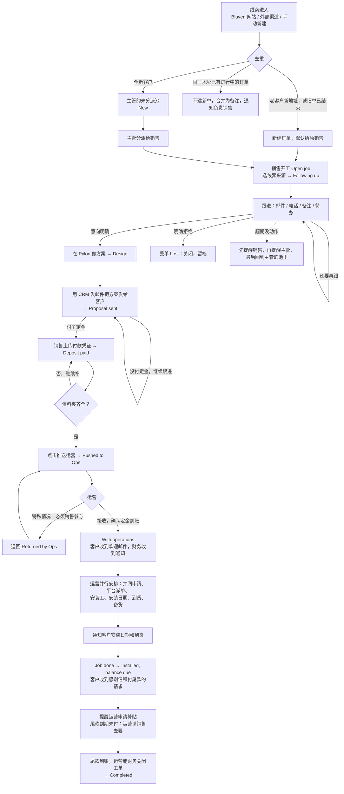

# Bluven CRM 流程说明（销售与运营）

版本：v2.0
日期：2026-11-15
读者：销售、销售主管、运营、财务，以及所有需要了解一张订单怎么走完的人
配套文档：技术设计见 `docs/sales-crm-design.md`

---

## 1. 这份文档说什么

CRM 管一张订单的全程：线索进来，销售跟进成交，运营安排安装，尾款到账，工单关闭。

这份文档按一条线索的实际走向，逐步说明每一步谁来做、系统自动做什么、做完之后订单处于什么状态。看完应该能回答三个问题：

1. 我现在手上这张订单处于哪一步，下一步该做什么。
2. 什么情况下系统会自动动作，什么情况下必须我动手。
3. 推给运营之前要准备齐哪些东西，运营接手之后各做什么。

系统界面是英文的，下文把界面上的英文名称和中文含义一起写出来。

这一版按 2026 年 11 月与负责人开会确认的流程重写。和上一版相比，最大的几处变化：销售要先"开工"并选线索来源；合同不再是必经的一步；定金不用等财务确认；运营接收之后的安装、尾款和关闭工单都进了系统。

---

## 2. 参与的人

| 角色 | 界面名称 | 看到什么 | 主要做什么 |
|---|---|---|---|
| 销售 | Sales | 只看自己名下的客户和订单，看不到同事的 | 开工并选线索来源、跟进客户、记录沟通、上传资料、发方案、记录定金、推送运营 |
| 销售主管 | Manager | 全部客户和订单 | 分派线索、改派、批量转移、维护线索来源列表、丢单原因和必填清单、看仪表盘和操作日志 |
| 运营 | Operations | 只看已经推送过来的订单，推送之前什么都看不到 | 接收订单并确认定金到账、安排工单各项、补资料、通知客户日期、标记完工、申请补贴、确认尾款、关闭工单 |
| 财务 | Finance | 有定金记录的订单里与钱有关的部分 | 收到"定金已到账""尾款已到账"的通知；可以确认尾款到账并关闭工单；处理退款 |
| 管理员 | Admin | 全部 | 用户、角色、接入渠道、系统规则、客户邮件模板 |

一个账号可以同时有多个角色，比如主管兼管理员。财务是独立账号。

---

## 3. 几个基本概念

**客户、房产、订单是三层。**
客户是人，房产是地址，订单是一次销售机会。一个客户可以有多处房产，每处房产可以有多张订单，比如两年后回来加装电池。我们日常说的"单子""job"就是订单。线索一进系统就是一张订单，只是处于最早的阶段。

**开工（Open job）。**
主管把线索分给销售之后，销售要在订单上点一下 Open job，这张订单才算他正式接手的 job。开工之前它只是一条线索：不能记电话、不能传资料、不能做报价，也不算任何人的业绩。

**线索来源和接入渠道是两回事。**

- 线索来源（Lead source）：客户是从哪里来的，比如合作方、购买的线索、客户转介绍、广告。销售开工时从下拉列表里必选，系统不会替你判断。合作方按它结算，所以要选准。
- 接入渠道（Intake channel）：这条线索是从哪条路进到系统里的，比如 Bluven 网站、表格导入、手动录入。系统自动记，不用管。

**所有沟通记录在客户的时间线上。**
邮件、电话、备注、阶段变化、资料上传、系统动作，按时间排成一条线。客户只有一张进行中的订单时，所有记录自动归到这张订单；有多张时，销售选一下归到哪张。

**文件夹按"客户 / 房产地址 / 订单号"三层展开。**
开工之后，这张订单的文件夹就可以用了。运营拿到一张订单，只会看到这一个地址的东西，不会混。

---

## 4. 一条线索的完整走向

下图是主线，后面逐步解释。

### 第 1 步：线索进入

线索有三条路进来：

- **Bluven 网站**：客户在网站提交询价或评估问卷，CRM 每分钟自动去网站后台取一次新线索，一两分钟内出现在未分派池。CRM 停机期间网站照常收集，恢复后自动补上，不会丢。
- **外部渠道**：购买的线索或合作方，由主管上传表格导入，或对方系统直接推送。
- **手动新建**：销售或主管自己录一条，比如电话打进来的。

系统地址是 `https://crm.bluven.com.au`，和公司网站在同一个域名下。

### 第 2 步：去重

线索进来时系统先按邮箱、电话、地址比对已有客户，有四种结果：

| 情况 | 系统怎么做 |
|---|---|
| 全新的人 | 新建客户、房产、订单，进未分派池 |
| 老客户，新地址 | 在老客户下新建房产和订单，默认分给原来的销售，原销售已离职则进池 |
| 老客户，同一地址，已有一张销售还在跟的订单 | 不建新单，把这次的内容作为一条备注追加到那张订单，通知负责销售 |
| 老客户，同一地址，之前的订单已经交给运营、已完成或已丢单 | 新建订单，默认分给原来的销售，主管可以改 |

认人靠电话和邮箱。如果只是地址相同而人对不上，系统不会自动合并，而是照常建单并标记"疑似重复"，由主管在池里判断：可能是配偶另外来咨询，也可能是房子换了主人。

手动新建和导入时也走同样的比对，界面会实时提示"疑似重复"。如果这位客户在别的销售名下，提示只会说"该联系人已存在，归属其他销售，请联系主管"，不会显示对方的客户资料。目的是不撞单：同一个客户不会出现在两个销售名下。

销售自己录线索时还有两条：

- 只能往自己的客户名下加单。客户属于别的销售时系统会拒绝，请找主管。
- 自己的老客户换了一个地址来询价，照常录入，系统会在这位客户名下新建一处房产和一张订单。同一个地址已经有进行中的订单时，系统提示去那张订单上继续。

### 第 3 步：主管分派

线索一入库阶段就是 **New**，在主管的 **Unassigned leads** 池里，主管会收到提醒。主管逐条或批量分给销售，负责销售收到通知。

### 第 4 步：销售开工，选线索来源

销售打开分给自己的订单，页面最上面是 **Open this job** 一栏：

1. 在 **Lead source** 下拉里选客户是从哪里来的。列表由主管维护，默认有：Bluven website、Partner、Purchased lead、Referral from a customer、Advertising、Called or walked in、Other / not known。
2. 需要的话在 **Who exactly** 里补一句具体是谁，比如哪家合作方、哪位老客户介绍的。
3. 点 **Open job**。

订单进入 **Following up**，文件夹和所有跟进功能随之打开。

几点说明：

- 线索来源必选，系统不会自动判断。拿不准就选 Other / not known，之后弄清楚了再改：点页面右上的 **Lead source** 按钮更正，更正有记录。
- 合作方按线索来源结算，仪表盘上有一张按来源统计的表，请认真选。
- 没开工的订单只能看、改客户和地址资料、建待办、暂缓或标记丢单。电话记录、资料、报价、定金、从 CRM 发信，都要先开工。
- 主管可以替销售开工。

### 第 5 步：跟进

销售在 CRM 里做日常跟进，所有动作都进客户的时间线：

- **邮件**：每个销售把自己的 Zoho 邮箱连到 CRM，做一次即可：点右上角自己的名字，选 Mailbox，点 Connect Zoho Mail。之后和客户的往来邮件在一两分钟内出现在订单的 **Email** 页，也进时间线。只同步和自己客户的往来：订单现在或曾经分配给你的客户，以及你从 CRM 写过信的客户。其他邮件不进系统，别的销售的客户写到你邮箱里的信也不进。几个人共用的邮箱，可以由邮箱主人在 Mailbox 页改成保存与所有客户的往来。
  - 在 Email 页点 **Write an email** 写信，点某封来信下面的 **Reply** 回信。信从自己的 Zoho 邮箱发出，Zoho 的已发送里也有。
  - 可以从 **Start from a template** 里选一个模板，客户姓名、地址、自己的名字已经填好，改一改再发。模板由主管维护。
  - 可以勾选订单里已有的资料作附件。收件人里至少要有一个是客户资料上已确认的邮箱，防止发错人。
  - 发件地址不在客户资料上时，信的上方有黄色提示：可能是客户换了邮箱，也可能根本不是客户。确认是客户本人后点一下，把新地址加到客户名下。
  - 随网站表单进来、加到已有客户名下的新邮箱，系统会标成"未确认"，因为任何人都能在表单里填别人的手机号和自己的邮箱。未确认的地址发来的信同样有黄色提示，方案也发不到这个地址。确认是客户本人后，在信上或者 Overview 页的客户卡片上点确认。
  - 客户有两张进行中的订单时，系统分不清邮件属于哪张，会放在 **Not on an order yet** 里，并通知负责销售，点 **It is about this order** 认领。
- **电话和微信、WhatsApp**：系统没法自动拿到，销售打完电话手动加一条记录，写清时间、内容、下一步。
- **备注**：随时写。客户信息、现场情况都记在这里或者客户、房产资料里。
- **待办**：给自己定"周二回电""明天发方案"，到期系统提醒。

**客户的三种情况，对应三种做法：**

| 客户的情况 | 销售做什么 | 订单状态 |
|---|---|---|
| 意向明确，要方案 | 点 **The customer wants a proposal**，去 Pylon 做设计（第 6 步） | Design |
| 还需要跟进 | 继续联系，记录每次沟通。客户说过一阵再联系的，用 **Put on hold** 并填回访日期 | Following up |
| 明确拒绝 | 点 **Mark as lost**，选原因 | Lost，订单关闭 |

标记丢单后订单关闭、不再提醒，但记录和资料留在系统里不删除，客户回头时主管可以恢复。资料按保留期（默认两年）到期后再清理。

**超期不跟进，系统会提醒并收回。** 按销售在这张订单上最后一次动作算：

| 多久没动作 | 系统做什么 |
|---|---|
| 5 天 | 提醒负责销售，并生成一条待办 |
| 8 天 | 提醒主管 |
| 10 天 | 自动回到主管的未分派池，销售和主管都收到通知，订单上留一条记录 |

- "动作"指销售推进这单生意的操作：开工、发邮件、记电话、写备注、传资料、报价、记定金、完成待办。客户来信不算，所以客户发了邮件没人回，照样会提醒。
- 新建待办、把待办改期、修改客户资料或地址，这些不算动作。
- 自动收回只发生在付定金之前。客户已经付了定金的订单闲置了只提醒，不会从销售手里收走。
- 收回之前一定提醒过。万一提醒没能按时发出，系统会先补发一条，说明两天后收回，这两天内有动作就不收。
- 订单在运营手里的时间不计闲置。丢单、暂缓、取消的订单也不计。
- 天数由管理员在 Administration → Rules 里调整，默认 5、8、10。
- 回池的订单保留开工记录和线索来源，下一位销售接手后直接继续。

销售离职或休假时，主管可以把他名下的订单批量转给别人，未完成的待办跟着订单走。

**资料随谈随传**，不要等成交。电费账单在做方案前就要，屋顶和电表箱照片越早越好。

AI 在这一步帮四件事。它写的、读的内容页面上都标着 Written by AI 或 Read by AI，都可能出错，用之前看一眼原文：

- **订单总结**：Overview 页最上面。点 **Write a summary**，半分钟左右写出现状、客户想要什么、顾虑、我们承诺过什么、建议下一步。客户来信后会自动重写。总结里如果发现了房产资料上还空着的信息（屋顶、楼层、相位、房产类型），会列出来，点 Use 采用，点 Dismiss 忽略。
- **回信草稿**：写信或回信的窗口里有 **Draft with AI**。先写一句想说什么，再点 Write a draft，草稿填进输入框。记录里没有的日期、价格会用方括号留空，补上再发。草稿不会自己发出去。
- **附件识别**：客户来信的附件旁会出现一行 AI 的判断，比如 "AI: Looks like: Electricity bill"，资料类型已经替你选好，确认无误点 **File** 归档。
- **账单读取**：文件进了 Electricity bill 资料夹后，系统自动读出电表号、零售商、账期、用电量和金额。房产资料里的 NMI 和零售商如果还空着，并且账单地址和订单地址对得上，会自动填上并标 from the bill。

### 第 6 步：客户意向明确，在 Pylon 做方案

点了 **The customer wants a proposal** 之后订单进入 **Design**。客户又犹豫了，可以点 **Back to following up** 回到跟进。

所有方案都在 Pylon 里设计。订单的 **Proposal & deposit** 页有一个 **Design in Pylon** 按钮（订单要先有地址；和 Pylon 项目关联之后，按钮变成 Open in Pylon），点开直接带着客户姓名、电话、邮箱、地址和 CRM 订单号进入 Pylon。订单号写进 Pylon 的项目参考号，这是两边对账的纽带。

Pylon 里每个设计对应 CRM 里的一个报价版本：容量、电池、总价、定金金额，以及 Pylon 网页报价的链接。还没发给客户的版本，在 Pylon 里改价会直接更新这一版；已经发出的版本再改价，才会新增一版。没有接通 Pylon 时，销售点 **Add quote version** 手动录入这几个数字，效果一样。

订单一旦关联了 Pylon 项目或者有了第一个报价版本，即使没点那个按钮，也会自动进入 Design。

如果这位客户的项目已经在 Pylon 里了（当初不是从 CRM 点过去建的），不用重建：在这一页点 **Link Pylon project**，把这个项目在 Pylon 里的网址粘贴进去，先点 Check 核对客户和地址，再点 Link project。想马上看到 Pylon 里刚改的内容，点 **Refresh from Pylon**。

一张订单只对应一个 Pylon 项目。确实要换项目时，由主管在这一页点 **Unlink from Pylon** 解除绑定。

### 第 7 步：把方案发给客户

发之前确认条款（T&Cs）在方案文件里。

- **用 CRM 发邮件（常用）**：把 Pylon 的方案 PDF 下载下来，通常只保留报价部分。在这一版报价上点 **Attach file** 把文件挂上去，再从订单的 Email 页写信并勾选它作附件。信从销售自己的邮箱发出，发送成功后这一版自动记为已发送，邮件也留在订单上。
- **在别处发的**：回到 CRM 对这一版点 **Mark as sent**，填发送时间，并把实际发出去的那个文件附上。
- **Pylon 网页报价**：客户在 Pylon 的网页上看方案。

方案发出后，订单进入 **Proposal sent**。已经发出的版本不能再改，改价就新增一个版本，每一版都留着。

**客户没付定金，就继续跟进。** 订单停在 Proposal sent，做法和第 5 步一样：联系、记录、定待办，超期不动同样会被提醒和收回。客户最终拒绝的，标记丢单。

### 第 8 步：客户付定金

客户付了定金，销售在 **Proposal & deposit** 页的 Deposit 一栏记录：

1. 订单有多个报价版本时，先选 **Proposal the customer accepted**：客户接受的是哪一版。只有一版时不用选。
2. 填金额。系统会按这一版的定金数预填。
3. 选付款方式，上传付款凭证：转账截图、收据，或者贷款批准件。
4. 需要的话写一句备注，比如付款人姓名或转账附言，方便运营对账。
5. 点 **Record deposit**。

订单进入 **Deposit paid**。

- **不需要先有合同，也不用等财务确认。** 钱是否到账，由运营在接收订单时核对（第 10 步）。
- 记错了可以点 **Withdraw** 撤回重记，推送之前都可以。
- 客户通过 Pylon 支付网关付定金的，系统自动生成定金记录，销售不用动。
- 客户签过字的文件可以存到同一页的 **Signed copy** 里，这是可选的，不影响后面任何一步。

### 第 9 步：备齐资料夹，推送运营

订单的 **Handoff** 页左边是 **The folder**，列出推送前必须齐的东西，缺哪项就标哪项，点 Fix 直接跳到该补的地方：

| 项目 | 说明 |
|---|---|
| Installation address | 安装地址完整：街道、区、州、邮编 |
| Proposal the customer accepted | 客户接受的那一版方案，带着发给客户的文件或 Pylon 网页报价链接 |
| Proof of the deposit | 定金付款凭证（第 8 步已上传） |
| Electricity bill | 电费账单 |
| Installation location photos | 现场 / 安装位置照片 |
| Meter box / switchboard photos | 电表箱 / 配电箱照片 |

后三类资料的清单由主管在 Administration → Handoff checklist 里维护，可以增减。

全部齐了，**Push to operations** 按钮才能点。推送前可以在 **Notes for operations** 里写给运营的话：客户偏好的时间、进门方式、养不养狗、答应过客户什么。

推送时系统把这张订单打包成一份"交接包"：客户和联系方式、房产信息、客户接受的方案、定金记录、全部资料、销售备注。订单进入 **Pushed to Ops**，运营收到通知。推送后一两分钟内，AI 写好一页交接简报放在运营的订单页上。

如果客户的邮箱还没有人确认过，这一页会提醒：运营接收时的欢迎邮件发不出去，请先在 Overview 页确认。

从推送这一刻起运营才能看到这张订单，包括全部邮件记录。推送之后销售不能再改订单内容。

### 第 10 步：运营接收

运营在 **Orders and jobs** 的 **To accept** 栏看到订单，打开核对交接包、资料和定金凭证，然后二选一。

**Accept order 接收。** 弹出的窗口里列着销售记录的定金金额、备注和凭证，有一个必须勾选的确认项：**The deposit of $… has arrived in the account**。先去看账户，钱到了再勾。接收之后：

- 订单进入 **With operations**，从此由运营接管。
- 定金记为已确认，财务收到"定金已到账"的通知。
- 销售和主管收到通知。
- 客户收到欢迎邮件（Welcome），从运营的邮箱发出。

钱还没到就先不接收，订单留在 To accept 里等。

**Return to sales 退回。** 这是特殊情况，见第 6 节。资料不够、照片不清楚这类问题，运营直接联系客户补上更快，不用退回。

### 第 11 步：运营安排工单

接收之后，订单页最上面是 **The job**，一共六项。它们是并行的，哪项先办妥先填哪项，互不等待：

| 项目 | 填什么 |
|---|---|
| Connection approval（并网申请） | 状态：未申请 / 已申请 / 已批准 / 本单不需要；可填申请编号 |
| Job assigned on（平台派单） | Formbay、GreenDeal、Bridge Select 或其他；可填平台上的工单号 |
| Installer（安装工） | 安装工姓名或公司，以及电工执照号 |
| Installation date（安装日期） | 日期 |
| Delivery（到货） | 送货上门并填预计到货日，或安装工自取 |
| Stock（备货） | 未确认 / 有库存不用买 / 需要订货 / 已订货 |

填完点 **Save**。右上角显示还有几项没办妥。每次改动都进时间线；安装日期定下或改期时，负责销售会收到一条通知，因为客户会问他。

运营在这一页还可以：

- **补资料**：Documents 一栏每类资料下面都有上传框。向客户或安装工要来的东西直接传在这里，比如重拍的电表箱照片、并网批复、合规证书、完工照片。运营只能替换和删除自己传的文件，销售归档的保持原样。
- **写备注**：Notes on the job。工单有什么特殊情况都写在这里，销售和主管在订单的 Operations 页能看到。
- **通知客户日期**：安装日期和到货方式都定了之后，点 **Send the dates to the customer**，客户收到一封写明安装日期、到货安排和安装工的邮件。日期改了可以再发一次。
- **取消订单**：工单做不下去时点 **Cancel order**，填原因和退款状态。销售和主管会收到通知。

销售和主管在订单的 **Operations** 页能看到以上全部内容，只能看不能改。客户来问进度，销售在这里就能查到。

### 第 12 步：完工、补贴、尾款

安装完成后，运营点 **Job done**。订单进入 **Installed, balance due**，同时：

- 客户收到一封感谢信：感谢选择 Bluven，满意的话请在 5 个工作日内付清尾款。
- 销售和主管收到完工通知。
- 两个提醒开始计时。

| 提醒 | 什么时候 | 提醒谁 |
|---|---|---|
| 申请补贴 | 完工后满 2 个工作日，补贴还没标为已申请 | 运营 |
| 尾款还没到 | 完工后满 5 个工作日，工单还没关闭 | 运营 |

- 补贴申请完，运营在 **After the installation** 一栏点 **Rebate applied for**。
- 尾款的提醒发给运营而不是销售，因为只有运营和财务看得到账户。运营先看账，钱确实没到，再点 **Ask sales to chase the balance**，可以写一句还差多少。负责销售收到通知和一条待办"Ask the customer for the balance"。
- 两个天数由管理员在 Administration → Operations and customer e-mails 里调整。周六周日不算工作日，公共假期目前不识别。

### 第 13 步：尾款到账，关闭工单

尾款到了，运营或财务点 **Final payment received**，可以填实收金额、到账日期和备注，然后 **Close the job**。

订单进入 **Completed**。财务、负责销售和主管都收到通知，销售名下那条催尾款的待办自动完成。

---

## 5. 订单阶段一览

| 界面显示 | 中文 | 什么时候进入 | 在谁手里 |
|---|---|---|---|
| New | 新线索 | 线索入库。未分派时在主管的池里；分派后、开工前也是 New | 主管 / 销售 |
| Following up | 跟进中 | 销售开工 | 销售 |
| Design | 设计方案 | 客户要方案，或订单有了 Pylon 项目或报价版本 | 销售 |
| Proposal sent | 方案已发 | 方案发给了客户。没付定金就停在这里继续跟进 | 销售 |
| Deposit paid | 已付定金 | 销售记录了定金并上传凭证 | 销售 |
| Pushed to Ops | 已推送运营 | 资料夹齐全，销售点了推送 | 运营（待接收） |
| Returned by Ops | 运营退回 | 运营退回并填了原因 | 销售 |
| With operations | 运营处理中 | 运营接收并确认定金到账 | 运营 |
| Installed, balance due | 已安装，待尾款 | 运营点了 Job done | 运营 |
| Completed | 已完成 | 尾款到账，工单关闭 | 结束 |

阶段不用手工拨，也拨不了：它是由订单上发生过的事算出来的。比如撤回了定金，订单自己回到 Proposal sent。

另有三个旁路状态，可以和上面的阶段并存：

| 界面显示 | 中文 | 规则 |
|---|---|---|
| Lost | 丢单 | 客户明确拒绝。原因必填，从列表里选，可加备注。订单关闭但留档，主管可以恢复。用于还没付定金的订单 |
| On hold | 暂缓 | 必须填回访日期。到期当天自动解除暂缓，生成一条跟进待办并提醒销售。推送之后不能暂缓 |
| Cancelled | 取消 | 用于付了定金之后客户反悔或工单做不下去，记录退款状态。运营接收之前由销售或主管取消，之后由运营或主管取消；完工之后不能取消 |

---

## 6. 几种特殊情况

**运营退回。**
退回不是常规做法，只在运营自己解决不了、必须销售参与时用，比如怎么都联系不上客户。运营点 **Return to sales**，原因必填。订单进入 Returned by Ops，负责销售和主管收到通知，销售名下多一条待办。销售处理完，在 Handoff 页点 **Push to operations again**。已经接收、还没安装的工单也可以退回，运营之前安排好的各项都保留；完工之后不能退回。

**资料不够。**
由运营跟进：直接向客户要，传到订单的 Documents 里。不需要退回。

**工单做不下去，或者不划算。**
由运营跟进：和客户、销售沟通后取消订单，填原因和退款状态。需要退定金的，财务在 Payments → Refunds to pay 里看到，付完后标记已退。

**客户没有邮箱，只有电话。**
正常建档，用电话跟进并手动记录。运营接收时的欢迎邮件等三封邮件发不出去，订单上会注明原因，由运营电话告知客户。有了邮箱随时补上并确认，运营可以在订单页点 **Send again** 补发。

**客户换了一个邮箱回信。**
如果这封邮件是在回复我们发出去的邮件，系统能认出来，会提示把新邮箱加到这位客户名下。

**老客户又来咨询。**
看第 2 步的四种情况。原则是：销售还在跟的单子就合并进去，没有就建新单并默认给原来的销售。

**一个客户有两处房子。**
两处房产各自一张订单，各自一套资料。属于房产的照片（电表箱、屋顶）在同一地址第二次下单时可以一键复用，界面会标注拍摄日期；账单、方案、定金凭证每单必须是新的。

**客户接受的不是最后发的那一版。**
记定金时选对版本即可。事后发现选错了，在报价列表里对正确的那一版点 **Customer accepted**。

**客户付了定金又反悔。**
把订单标为 Cancelled，记录退款状态。

**订单已经丢单或取消，客户却在 Pylon 上签了字或付了款。**
订单状态不会自己变，但时间线上会记一笔，销售和主管会收到通知，涉及付款时财务也会收到。丢单的订单可以由主管恢复后继续走；已取消的订单不能恢复，需要为客户新建一张订单。

**从历史数据导进来的老订单，客户又来询价。**
这张订单会自动转入未分派池并通知主管，按新线索处理。

---

## 7. 资料与文件夹

| 资料类型 | 属于 | 第二单能否复用 | 谁来传 |
|---|---|---|---|
| 电表箱照片、屋顶 / 安装位置照片、额外现场照片 | 房产 | 可以，界面标注拍摄日期 | 销售；运营可补 |
| 电费账单 | 订单 | 不可以，每单新的 | 销售；运营可补 |
| 方案文件、定金凭证、签字版 | 订单 | 不可以 | 销售，在 Proposal & deposit 页 |
| 并网批复、合规证书等（Approvals and certificates） | 订单 | 不可以 | 运营 |
| 完工照片（Photos of the finished installation） | 房产 | 可以 | 运营 |

文件存在公司服务器上。单个文件有上限：资料页默认 500 MB（部署在 Railway 上是 200 MB）；方案文件、签字版、定金凭证一次提交合计不超过 60 MB、最多 10 个文件。

**谁什么时候能往文件夹里放东西。** 销售从开工到推送之前，以及被退回期间。运营从订单推送过来到工单关闭之前。工单关闭后文件夹只读。

**资料保留多久。** 默认两年，从订单结束那天起算。结束指工单关闭、丢单或取消，进行中的订单没有到期日。签字版、定金凭证和 Approvals and certificates 永不自动到期。

- 到期前 30 天，负责销售和主管各收到一次提醒。打开订单的 Documents 页，最上面会列出到期的文件，两个按钮：**Keep for another year** 再保留一年，**Delete now** 现在删除。
- 主管在左侧导航的 **Documents to review** 里能看到所有等待处理的订单。
- 没人处理的话，默认什么都不删，每周再提醒主管一次。管理员可以在 Rules 里打开"到期自动删除"。
- 删除后文件立刻从订单里消失，30 天后从服务器上移除，不论哪一类资料。
- 年数、提前提醒的天数由管理员在 Administration → Rules 里设置；某一类资料要单独的年数，在 Handoff checklist 里设。

几条规则：

- 签字版被移除或替换、定金记录被撤回之后，当时的文件会归到 **No longer current** 一栏。它们留档可查，但不算进清单，也不会出现在给运营的交接包里。
- 签字版和定金凭证不能在资料页直接删除，只能在 Proposal & deposit 页处理。
- 已经发给客户的方案文件不能替换；当时没带文件的可以事后补上。
- 每一次查看和下载文件都有记录。

---

## 8. 系统自动做的事

| 时机 | 自动动作 |
|---|---|
| 线索进入 | 去重、进池、提醒主管 |
| 分派后 5 / 8 / 10 天没动作 | 提醒销售并生成待办、提醒主管、收回入池（收回前必先提醒；付了定金的不收回） |
| 收到客户邮件 | 一两分钟内同步进 Email 页和时间线，通知负责销售；AI 看附件并建议资料类型；两分钟后重写订单总结 |
| 从 CRM 发信 | 记为一次联系；附了方案文件的，那一版记为已发送，订单进 Proposal sent |
| 文件进入 Electricity bill 资料夹 | AI 读出电表号、零售商、用电量等；地址对得上时，空着的 NMI 和零售商自动填上 |
| 订单关联了 Pylon 项目，或 Pylon 出了新设计 | 记一个报价版本，订单进 Design |
| 客户在 Pylon 网页上签字 | 存下签字文件，把那一版标为客户接受，提醒销售记录定金 |
| Pylon 网关收到定金 | 生成定金记录，订单进 Deposit paid |
| 销售点推送 | 检查资料夹、生成交接包、通知运营；一两分钟内 AI 写好交接简报 |
| 运营接收 | 确认定金、通知财务、通知销售和主管、给客户发欢迎邮件 |
| 运营定下或更改安装日期 | 通知负责销售 |
| 运营点"发送日期" | 给客户发安装日期和到货安排的邮件 |
| 运营点 Job done | 给客户发感谢信并请求付尾款，通知销售和主管 |
| 完工后满 2 个工作日 | 补贴还没申请：提醒运营 |
| 完工后满 5 个工作日 | 工单还没关闭：提醒运营看账，必要时请销售催款 |
| 尾款确认到账 | 工单关闭，通知财务、销售和主管，催款待办自动完成 |
| 运营退回 | 通知销售和主管，生成待办 |
| 暂缓到期 | 自动解除暂缓，生成待办并提醒 |
| 资料到期前 30 天 | 提醒销售和主管；过期没人处理则每周提醒主管 |
| 每天早上 7 点后 | 给选择了每日摘要的人发一封邮件，列出上一次摘要之后新产生、还没读的通知 |

**自动发给客户的三封邮件**（欢迎、安装日期、感谢并请付尾款）：

- 文字由管理员在 Administration → Operations and customer e-mails 里维护，每封都可以单独关掉。可以用 `{{first_name}}`、`{{address}}`、`{{order_no}}`、`{{install_date}}`、`{{delivery}}`、`{{installer}}`、`{{balance_days}}` 等字段，页面底部有完整列表。
- 从哪个邮箱发：管理员在同一页选一个已经连到 CRM 的邮箱，建议用运营的公共邮箱。没选的话，用执行那一步的人自己连接的邮箱。客户的回信会回到这个邮箱，也出现在订单的 Email 页。
- 只发到已确认的客户邮箱。发不出去的会留在订单的 **E-mails to the customer** 一栏，写明原因，运营处理后点 **Send again**。
- 发出的每一封都能在订单上点 Read it 看到原文。

AI 自动做的那几件事，管理员可以在 Administration → AI assistant 里逐项关掉。

所有人工和自动的动作都有操作日志：谁、什么时候、改了什么、改前改后是什么。日志只增不删。

---

## 9. 通知和报表

**通知。** 左侧 Notifications 页列出所有通知，可以按类型筛选：线索与分派、闲置提醒、客户邮件、定金与尾款、运营、待办、资料、Pylon。每类旁边是未读数，也可以只看未读。

通知是否同时发到邮箱，取决于部署时有没有配置通知邮件（部署指南第 9 节）：配置了就发，在系统里已经读过的不发；没配置时只有系统内通知，每日摘要也不发。客户来信的通知只在系统内显示，因为那封信本身已经在你的邮箱里。嫌邮件多的人，在 Notifications 页底部勾上 **Send me one summary each morning**，改成每天早上一封摘要。这是每个人自己的选择。服务器没有配置通知邮件时，这个选项不显示，页面上会说明。

**订单列表。** All orders / My orders 默认显示还在销售手里的订单，按阶段分组。**Show** 下拉可以切到 With operations（运营处理中）、Completed（已完成）、On hold、Lost、Cancelled 或 Everything。可以按线索来源（Lead source）和接入渠道（Came in through）筛选。

**报表。** 主管的 Dashboard 和销售的 My numbers 是同一张报表，销售只看到自己的订单。

- 上半部分是所选日期区间内的数字：新线索、付定金（成交）、运营接收、完成工单、丢单，以及从线索到付定金平均用了多少天。成交按定金记录的日期算。
- "Right now" 一排是此刻的数字：未分派线索、已付定金待推送、被运营退回，以及闲置三档（默认 5、8、10 天）。每个数字点进去就是它数的那些订单。
- **By lead source**：按销售开工时选的线索来源统计。每个来源开工多少单、付定金多少单、这些成交的方案总价合计、完成多少单。合作方按这张表结算。
- Leads by intake channel：按线索进入系统的渠道看转化。
- Last twelve months 是最近十二个自然月的线索、定金、运营接收、完成和丢单。
- **Export orders (CSV)** 导出所选区间内进线的订单明细，每张订单一行，带线索来源和到达各阶段的日期，可以在 Excel 里自己再算。导出会记入操作日志。

**运营的列表。** Orders and jobs 分五栏：To accept（待接收）、Being arranged（安排中，按安装日期排，显示还差哪几项）、Installed, balance due（已安装待尾款，显示是否逾期）、Back with sales（退回销售）、Closed（已关闭）。

**财务的列表。** Payments 分四栏：Deposits（定金）、Balances due（应收尾款）、Final payments received（已到账尾款）、Refunds to pay（待退款）。

---

## 10. 启用前要做什么

功能都已做完，其中几样要先配置才会启用。没配置时相关页面仍在，只显示"未设置"的提示，其余功能照常使用。

| 功能 | 状态 | 启用前要做什么 |
|---|---|---|
| 线索、分派、开工、订单阶段、资料与清单、定金、推送与退回、运营工单、尾款与关闭、操作日志、报表、通知、资料保留 | 可用 | 主管先看一眼 Administration → Lead sources，把合作方等来源补全 |
| Pylon 对接 | 可用 | 在 Pylon 建一个只读的 API token 填进系统，见部署指南第 6 节 |
| Zoho 邮件同步、从 CRM 发信、邮件模板 | 做完，未连过真实 Zoho | 在 Zoho 登记一次应用，然后每个销售连接自己的邮箱，见部署指南第 7 节 |
| 自动发给客户的三封邮件 | 做完，未连过真实 Zoho | 同上；另外运营把公共邮箱连到 CRM，管理员在 Operations and customer e-mails 里选它，并看一遍三封邮件的文字 |
| AI 总结、回信草稿、附件识别、账单读取、交接简报 | 做完，未用真实密钥调用过 | 申请一个 Anthropic 密钥填进系统，见部署指南第 8 节 |
| 通知邮件、每日摘要 | 可用 | 配置邮件中继或 SMTP，见部署指南第 9 节。没配置时只有系统内通知 |

没有接邮件的时候：发了方案手动点 Mark as sent；和客户的邮件往来手动记一条；三封客户邮件系统照样写好留在订单上并注明没发出，由运营自己联系客户。

本期没有做的：

- 与财务软件 Xero 的对接。现在只做到通知财务。
- 按客户或销售所在地分别计算时间。全公司统一按悉尼时间。
- 公共假期。工作日只跳过周六周日。
- 客户自己查进度的页面。
- 手机端，手机拍的 HEIC 照片自动转换，从 CRM 直接在 Pylon 里创建项目。
